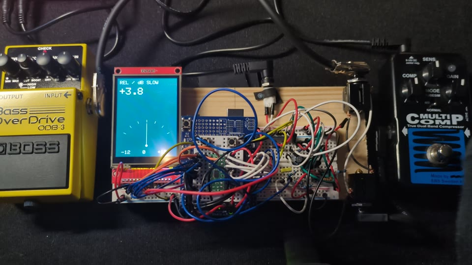
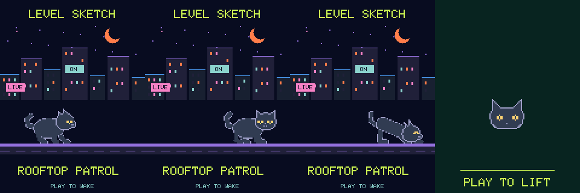

# Level Sketch

ギターやベースのペダルボードで使う、画面を自分でプログラムできるレベルメーターです。クリーン音を基準に決めると、ペダルを踏んだ前後の音量差を針で読めます。VIEWを押すと強く弾くほど黒猫が高く上がる画面に切り替わり、休憩中は猫がネオン街の屋上を巡回します。

## 組み立てて試す

1. UNO R3、MSP2807、レベル変換基板、MCP6002と受動部品を用意し、無通電で配線します。入力とTHRUの間は直結し、分岐した信号を測定します。[部品表](hardware/parts.md)・[配線図](hardware/breadboard.svg)・[穴番号](hardware/connections.md)・[回路図](hardware/schematic.svg)
2. 最初はUSBで電源と中点電圧を確認します。ペダル電源は専用ジャック **J3（安定化9 V DC、センターマイナス）** に接続します。UNO本体のDCジャックはセンタープラスです。[通電・電源試験](hardware/bring-up.md)・[電源経路](hardware/power-path.svg)
3. Arduino IDEのスケッチブックの `libraries` へ [LevelSketchフォルダ](firmware/LevelSketch) を丸ごとコピーします。ボードマネージャーからArduino AVR Boards、ライブラリマネージャーからAdafruit ILI9341 1.6.3と依存ライブラリを導入します。IDEを開き直し、「スケッチ例 → LevelSketch → MultiView」を選び、Arduino Unoと使用ポートを指定して書き込みます。
4. INへ楽器、THRUへ次段を接続します。猫は校正前でも試せます。針と数値を使うには440 Hzの正弦波を入れ、入力端子で実効値を測ります。例えば実測100 mV RMSなら、シリアルモニターを115200 bps・改行ありにして `CAL 100` を送り、`CAL SAVED` を確認します。[校正用トーン](assets/calibration-440Hz.wav)・[校正手順](hardware/bring-up.md)

## 手での操作

| 操作 | 動作 |
| --- | --- |
| VIEW短押し／約0.7秒長押し | 短押しで針と猫を切り替え、長押しで屋上パトロールへ |
| MODE短押し | 校正後、絶対レベル（dBV）と手動基準との差（dB）を切り替え |
| SPEED短押し | 針の応答をSLOW（300 ms）とFAST（60 ms）で切り替え |
| MODEを約0.7秒長押し | 基準設定へ。MODEで−1、SPEEDで＋1 dB。再びMODE長押しで保存 |

例えばクリーン音が−18 dBVなら、手動基準を−18 dBVに合わせます。ペダルを入れて−15 dBVになると相対表示は＋3 dBです。無音が約60秒続くと屋上パトロールへ移り、次の一音で復帰します。入力開放時に待機へ移らない場合は、楽器をつないで音量をゼロにして試せます。

## 自分の画面で遊ぶ

このリポジトリをクローンまたはフォークして、自分の楽器に合うメーターや待機画面を作って遊んでください。猫の顔を改変するなら [AmpCat](firmware/LevelSketch/examples/AmpCat)、屋上の背景や歩き方なら [RooftopPatrol](firmware/LevelSketch/examples/RooftopPatrol) をフォルダごとコピーして開きます。RooftopPatrolは起動直後からアニメーションを全画面で確認できます。複数の画面を組み合わせる作例は [MultiView](firmware/LevelSketch/examples/MultiView) です。`MultiView.ino` 冒頭で画面の順番や待機時間、針の応答を変更できます。猫の感度やまばたきは `AmpCat.cpp`、屋上の景色と歩き方は `RooftopPatrol.cpp` で編集します。ボタン、測定、校正は共通ライブラリが受け持ちます。[画面の作り方とサンプルコード](docs/画面の作り方.md)

実機で確認した項目と精度・発熱の試験方法は[組み立てガイド](hardware/bring-up.md)、図面などの利用条件は[クレジット](THIRD_PARTY_NOTICES.md)にまとめています。

## 開発用の資料

- [編集用のFritzingプロジェクト](hardware/LevelSketch.fzz)
- [全作例のUNO向けビルド手順と依存ライブラリのバージョン](.github/workflows/uno.yml)
- [USB測定ログの記録ツール](tools/log_meter.py)。pyserialをインストールし、シリアルモニターを閉じて、ポート名と新規CSVファイル名を指定します。

## ライセンス

自作のコード、猫の絵、文書などは[MITライセンス](LICENSE)で配布します。著作権表示とライセンス本文を添えて、改変したスケッチも再配布できます。Fritzingを使った回路資料にはCC BY-SA 3.0が適用されます。[対象ファイルと帰属表示](THIRD_PARTY_NOTICES.md)
